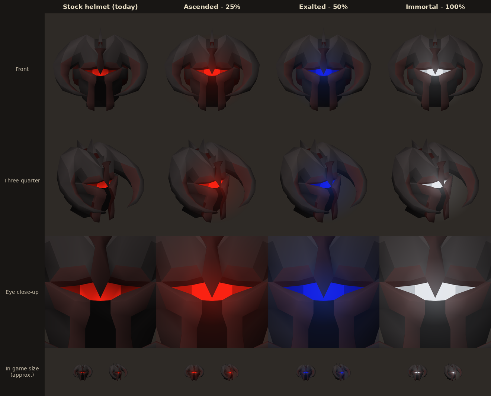

# Combat Masteries

A RuneLite plugin that adds an achievement system beyond Grandmaster Combat Achievements.
Where Combat Achievements teach PvM, Combat Masteries recognise mastering it: speed and
challenge tasks from endgame content, mostly solo, and deliberately aspirational.

- **Tasks** are worth 1 point each. Each is either **Speed** or **Challenge**. Tasks are only
  ever added (new content, or new time tasks as gear improves), never removed.
- **Tiers** unlock at a fixed share of all points, so thresholds rise as tasks are added:

  | Tier | Needs | Tzkal slayer helmet eyes |
  |---|---|---|
  | Ascended Grandmaster | 25% of points | Glowing red |
  | Exalted Grandmaster | 50% of points | Glowing dark blue |
  | Immortal Grandmaster | 100% of points | Glowing white (Radiant oathplate's white) |

- **Reward**: the eyes of your Tzkal slayer helmet glow in your tier's colour. This is
  client-side only, so only you see it, and it only shows while you wear the helmet.



*Offline render of the helmet's real model (42733) from the game cache. It uses the client's
lighting and RuneLite's colour conversion, so in-game results should be close but not identical.*

> **Status:** prototype. 37 tasks are in. Tasks with times still TBD are listed under
> [Planned tasks](#planned-tasks).

## Testing in-game

You need a JDK (11 or newer) and Git.

```bash
git clone <this repository>
cd combat-masteries
./gradlew run
```

This starts a RuneLite development client with the plugin loaded. To log in with a Jagex
account, follow [Using Jagex Accounts](https://github.com/runelite/runelite/wiki/Using-Jagex-Accounts)
once first.

### Developer commands

The dev client runs in developer mode, which enables these chat commands. They do nothing in
a normal RuneLite install.

| Command | What it does |
|---|---|
| `::cmtier ascended` / `exalted` / `immortal` / `off` | Preview a tier's eyes without unlocking it |
| `::cmkill Boss_Name m:ss [team=N] [level=N] [total=m:ss] [pillars]` | Pretend a kill happened, to test task completion. Use `_` for spaces |
| `::cmdelve N` | Pretend your deepest Doom delve is N |
| `::cmtrip` | Show kills on the current inventory and what last ended a trip |
| `::cmattempt` | Show the current Inferno run and pillars seen |
| `::cmreset` | Wipe this account's mastery progress |

Examples: `::cmkill TzKal-Zuk 44:59`, `::cmkill Theatre_of_Blood 22:30 team=2`,
`::cmkill Tombs_of_Amascut:_Expert_Mode 30:00 team=1 level=600 total=33:00`.

### What to check

1. **Helmet**: wear a Tzkal slayer helmet and try `::cmtier ascended`, `exalted` and
   `immortal`. Check with the GPU plugin on and off, and with 117 HD if you use it.
   `::cmtier off` should restore the stock eyes.
2. **Side panel**: the sidebar's helmet icon lists the tasks with Speed/Challenge and content filters.
3. **Real content**, whenever you run it:
   - **Raids:** after a ToB or ToA, check the chat for a completion message. Also confirm that
     solo vs. duo and the ToA raid level were picked up, using a matching dev kill as a reference.
   - **Inferno:** run `::cmattempt` after wave 4 starts. It should show pillars seen 3, and
     `pillarsCleared=true` only if all three were down.
   - **Awakened DT2:** after each kill, `::cmtrip` should list it. Banking, a pool, an altar,
     picking up food or potions, dying, or a heal/veng/energy transfer from someone else
     should clear it.
   - **Doom:** delve tasks should complete as soon as you log in, if you have already been that deep.

## How tracking works

- **Times** come from the game's own completion messages. Turn on *Settings → Precise timing*
  in-game. "Sub 40:00" means strictly under 40:00. ToB tasks use the **completion time**;
  ToA tasks use the **total completion time**.
- **Team size** comes from the game: Chambers of Xeric prints it, and ToB/ToA store it in game
  data RuneLite can read. **ToA raid level** is read the same way.
- **Doom delves** come from the game's permanent record of your deepest delve, so delves you
  already reached count straight away.
- **No Pillar Inferno**: the plugin counts the three pillars when the run starts. When wave 4
  begins, none may be standing.
- **One inventory**: kills are counted per trip. A trip ends when you open a bank (including
  group storage), drink from a pool, pray at an altar, gain food or potions (potions count by
  dose, so combining them is fine), die, or receive heal other, heal group, energy transfer or
  vengeance other. Teleporting is allowed.
- **Existing personal bests** credit time tasks without a raid level or pillar rule. They come
  from kill messages and from RuneLite's Chat Commands plugin (which also reads your POH
  adventure log).
- Progress only counts on normal worlds: not Leagues, Deadman, beta, speedrunning or
  tournament worlds. Everything is stored locally; nothing is sent anywhere.

## Writing tasks

Tasks live in `src/main/resources/com/combatmasteries/tasks.json`:

```json
{
  "id": "tob_duo_sub_22",
  "name": "Sub 22:00 Duo ToB",
  "description": "Complete the Theatre of Blood in a duo in under 22:00 (completion time).",
  "category": "SPEED",
  "content": "Theatre of Blood",
  "boss": "Theatre of Blood",
  "conditions": [{ "type": "TEAM_SIZE", "value": 2 }, { "type": "UNDER_TIME", "seconds": 1320 }]
}
```

- `boss` is the name exactly as the kill count message prints it ("Your completed
  **Theatre of Blood: Hard Mode** count is...").
- `conditions` must all hold for one kill or raid:

  | Type | Field | Meaning |
  |---|---|---|
  | `UNDER_TIME` | `seconds` | Strictly faster than this |
  | `TEAM_SIZE` | `value` | Exactly this many players (1 = solo) |
  | `MIN_RAID_LEVEL` | `value` | ToA raid level of at least this |
  | `MIN_DELVE_LEVEL` | `value` | Deepest Doom delve of at least this (no `boss` needed) |
  | `INFERNO_NO_PILLARS` | | All pillars down before wave 4 |

- `trip` instead of `conditions` makes a one-inventory task, e.g.
  `"trip": { "Leviathan (awakened)": 2 }`.
- `"tracked": false` lists a task (it counts towards the total) before the plugin can detect it.
- Never change an `id` after release: progress is saved against it.

## Planned tasks

These are waiting on time thresholds or game details:

- Solo CM CoX: 6 time tasks (times TBD)
- Trio, 4-man and 5-man ToB: 5–6 time tasks each (times TBD)
- Solo ToA 300 speed: 6 time tasks (times TBD)
- Duo HMT speed (times TBD)
- Oathplate contract (details TBD)
- Radiant Contracts is listed but shows "Tracking soon" until its kill message is confirmed

## Credits

The kill message patterns are adapted from RuneLite's Chat Commands plugin (BSD-2-Clause).
