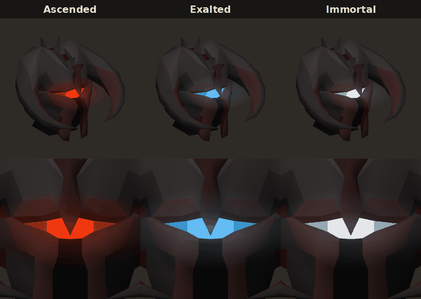
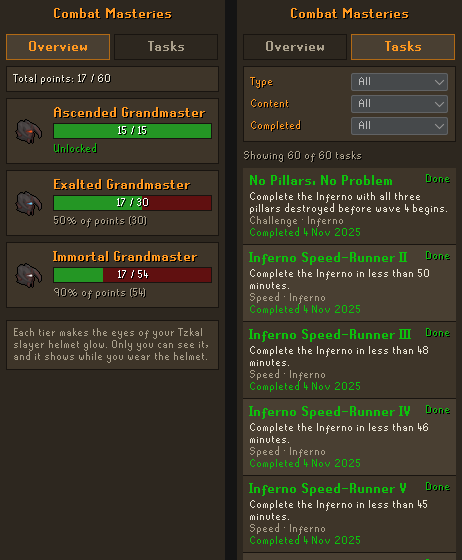

# Combat Masteries

A RuneLite plugin that adds an achievement system beyond Grandmaster Combat Achievements.
Where Combat Achievements teach PvM, Combat Masteries recognise mastering it: speed and
challenge tasks from endgame content, mostly solo, and deliberately aspirational.

- **Tasks** are worth 1 point each. Each is either **Speed** or **Challenge**. Tasks are only
  ever added (new content, or new time tasks as gear improves), never removed.
- **Tiers** unlock at a fixed share of all points, rounded down (90% of 92 tasks is 82.8, so 82),
  so thresholds rise as tasks are added:

  | Tier | Needs | Tzkal Slayer Helmet eyes |
  |---|---|---|
  | Ascended Grandmaster | 25% of points | Red drifting to orange |
  | Exalted Grandmaster | 50% of points | Ice blue drifting to azure |
  | Immortal Grandmaster | 90% of points (like the gilded collection log staff) | Radiant oathplate's white drifting to a cool white |

- **Reward**: the eyes of your Tzkal Slayer Helmet glow in your tier's colour. This is
  client-side only, so only you see it, and it only shows while you wear the helmet.



*Earlier offline render of the helmet's real model (42733). The glow now has no screen halo:
the brightness travels slowly across the slit over 12 seconds, and a little of the colour
spills onto the metal around the eyes.*



> **Status:** prototype. 65 tasks are in. Tasks with times still TBD are listed under
> [Planned tasks](#planned-tasks).

## Testing in-game

You need a JDK (11 or newer) and Git.

```bash
git clone <this repository>
cd combat-masteries
./gradlew run
```

This starts a RuneLite development client with the plugin loaded. To log in with a Jagex
account, follow [Using Jagex Accounts](https://github.com/runelite/runelite/wiki/Using-Jagex-Accounts)
once first.

### Developer commands

The dev client runs in developer mode, which enables these chat commands. They do nothing in
a normal RuneLite install.

| Command | What it does |
|---|---|
| `::cmtier ascended` / `exalted` / `immortal` / `off` | Preview a tier's eyes without unlocking it |
| `::cmkill <boss> [time] [solo/duo/trio] [level=N] [total=m:ss] [pillars]` | Pretend a kill happened, to test task completion |
| `::cmdelve N` | Pretend the game's deepest Doom level record is N |
| `::cmdoom` | Show the game's Doom delve values |
| `::cmtoa` | Show the ToA raid level, whether it's locked in, and the peak this raid |
| `::cmhelm` | Diagnose the helmet glow: helmet detected, eye faces found, colours applied |
| `::cmtrip` | Show kills on the current inventory and what last ended a trip |
| `::cmattempt` | Show the current Inferno run and pillars seen |
| `::cmreset` | Wipe this account's mastery progress |

`::cmkill` understands short names: `inferno`, `colo`, `tob`, `hmt`, `toa`, `cm`,
`awakened levi`, `awakened vard`, `awakened duke`, `awakened whisperer`. Exact kill-message names
work too, with `_` for spaces. Examples:

- `::cmkill Solo ToB 44:44`: solo ToB in 44:44
- `::cmkill duo tob 21:30`
- `::cmkill inferno 44:59 pillars`: also counts as a No Pillar run
- `::cmkill toa 30:00 solo level=600`: ToA uses the total time, which defaults to the same time
- `::cmkill awakened levi`: no time needed for one-inventory tasks

### What to check

1. **Helmet**: wear a Tzkal Slayer Helmet and try `::cmtier ascended`, `exalted` and
   `immortal`. Check with the GPU plugin on and off, and with 117 HD if you use it.
   `::cmtier off` should restore the stock eyes.
2. **Side panel**: the sidebar's helmet icon lists the tasks with Speed/Challenge and content filters.
3. **Real content**, whenever you run it:
   - **Raids:** after a ToB or ToA, check the chat for a completion message. Also confirm that
     solo vs. duo and the ToA raid level were picked up, using a matching dev kill as a reference.
   - **Inferno:** run `::cmattempt` after wave 4 starts. It should show pillars seen 3, and
     `pillarsCleared=true` only if all three were down.
   - **Awakened Bosses:** after each kill, `::cmtrip` should list it. Banking, a pool, an altar,
     picking up food or potions, a looting bag, dying, or a heal/veng/energy transfer from
     someone else should clear it. Logging out or hopping should not.
   - **Doom:** after a delve, run `::cmdoom` and tell me the deepest level you *cleared* and
     what "deepest" shows. That settles whether the game's record means reached or cleared.

## How tracking works

- **Times** come from the game's own completion messages. Turn on *Settings → Precise timing*
  in-game. "Sub 40:00" means strictly under 40:00. ToB tasks use the **completion time**;
  ToA tasks use the **total completion time**.
- **Team size** comes from the game: Chambers of Xeric prints it, and ToB/ToA store it in game
  data RuneLite can read. **ToA raid level** is the highest level during the raid, because
  missed invocation time limits lower the level shown at the end (a full 600 finishes as 575).
- **Doom 1–N** means clearing delve levels 1 to N in one delve. It's read from the game's
  permanent record of your deepest level, so past delves count straight away. Until it's
  confirmed whether that record means reached or cleared, level N only counts once level N+1
  is on record. This can delay a task, but never awards one early.
- **No Pillar Inferno**: the plugin counts the three pillars when the run starts. When wave 4
  begins, none may be standing.
- **One inventory**: kills are counted per trip. A trip ends when you open a bank (including
  group storage), drink from a pool, pray at an altar, gain food or potions (potions count by
  dose, so combining them is fine), carry a looting bag, die, or receive heal other, heal group,
  energy transfer or vengeance other. Teleporting, logging out and changing worlds are allowed.
- **Existing personal bests** credit time tasks without a raid level or pillar rule. They come
  from kill messages and from RuneLite's Chat Commands plugin (which also reads your POH
  adventure log).
- **Announcements** match the game's combat tasks: the same chat wording and green task name,
  "You have failed …" messages (a pillar standing at wave 4, or a one-inventory trip ending
  early), and the game's own task-completed pop-up. Each can be turned off in the plugin's settings.
- Progress only counts on normal worlds: not Leagues, Deadman, beta, speedrunning or
  tournament worlds. Everything is stored locally; nothing is sent anywhere.

## Writing tasks

Tasks live in `src/main/resources/com/combatmasteries/tasks.json`:

```json
{
  "id": "tob_duo_sub_22",
  "name": "Sub 22:00 Duo ToB",
  "description": "Complete the Theatre of Blood in a duo in under 22:00 (completion time).",
  "category": "SPEED",
  "content": "Theatre of Blood",
  "boss": "Theatre of Blood",
  "conditions": [{ "type": "TEAM_SIZE", "value": 2 }, { "type": "UNDER_TIME", "seconds": 1320 }]
}
```

- `boss` is the name exactly as the kill count message prints it ("Your completed
  **Theatre of Blood: Hard Mode** count is...").
- `conditions` must all hold for one kill or raid:

  | Type | Field | Meaning |
  |---|---|---|
  | `UNDER_TIME` | `seconds` | Strictly faster than this |
  | `TEAM_SIZE` | `value` | Exactly this many players (1 = solo) |
  | `MIN_RAID_LEVEL` | `value` | ToA raid level of at least this |
  | `MIN_DELVE_LEVEL` | `value` | Doom delve levels 1 to this cleared (no `boss` needed) |
  | `INFERNO_NO_PILLARS` | | All pillars down before wave 4 |

- `trip` instead of `conditions` makes a one-inventory task, e.g.
  `"trip": { "Leviathan (awakened)": 2 }`.
- `"tracked": false` lists a task (it counts towards the total) before the plugin can detect it.
- Never change an `id` after release: progress is saved against it.

## Planned tasks

- You Did What? is listed but shows "Tracking soon" until its kill message is confirmed

## Credits

The kill message patterns are adapted from RuneLite's Chat Commands plugin (BSD-2-Clause).

The window's screenshot button uses the camera icon of RuneLite's Screenshot plugin
(`src/main/resources/com/combatmasteries/screenshot.png`, from RuneLite, Copyright (c) 2016-2017,
Adam <Adam@sigterm.info>, BSD-2-Clause).
